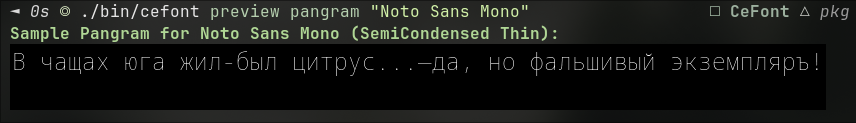
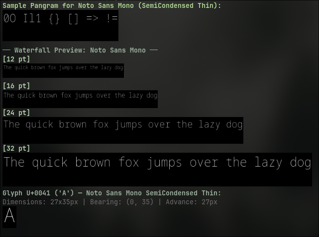
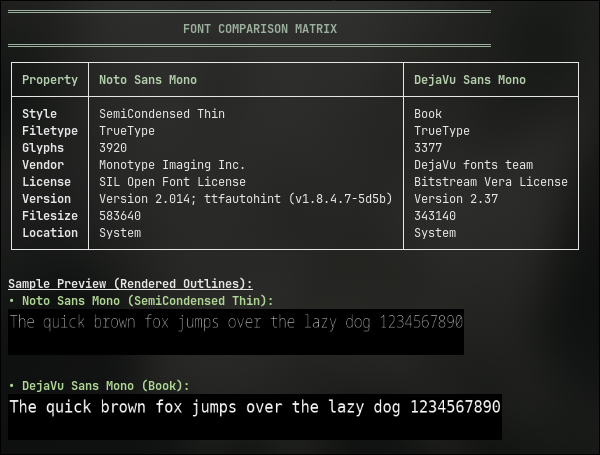
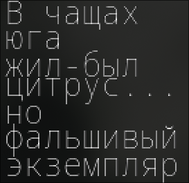
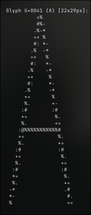
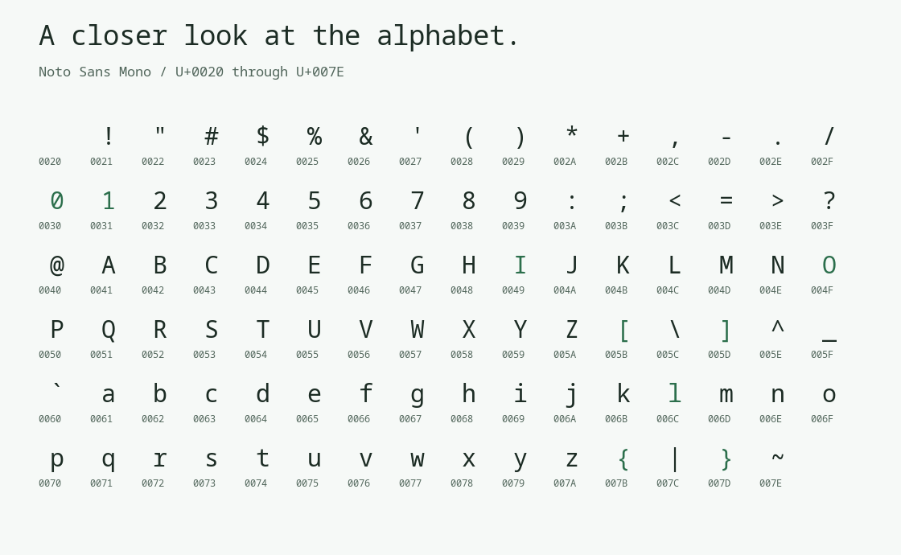
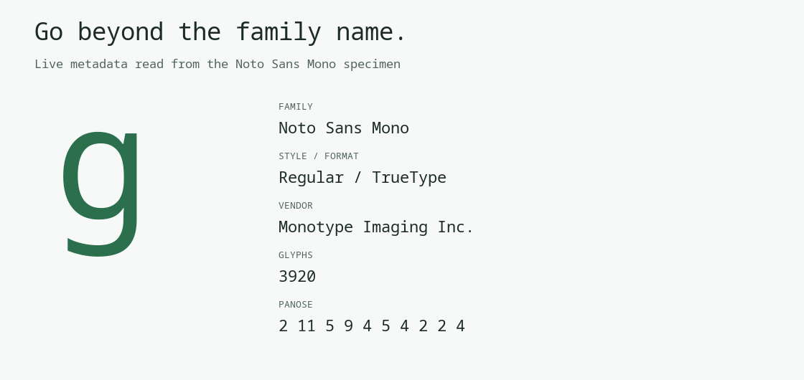
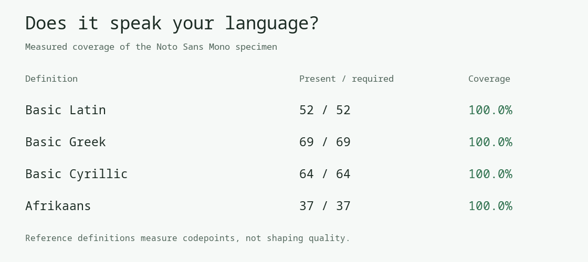
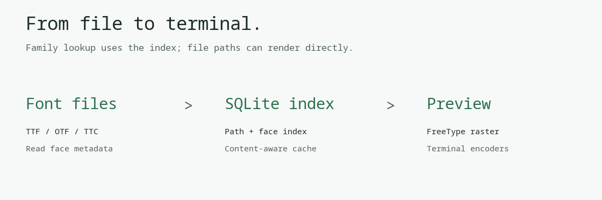

# CeFont

**Release target: 0.10.0 Alpha 1 (`0.10.0a1`)**

Experimental Linux pre-release. ARM64 builds have not been tested on ARM hardware.

### Your fonts. In your terminal.

Inspect metadata, compare real glyphs, and manage your Linux font library from the command line.

[Quick start](#quick-start) / [Preview fonts](#preview-fonts) / [Inspect glyphs](#inspect-glyphs) / [Organize](#organize-fonts) / [Credits](#credits-and-license)


*Typographic illustration. The guides below combine original terminal screenshots with native-rendered specimens and measured font data.*

> **Built on Font Manager.** CeFont is an independently developed hard fork of [FontManager/font-manager](https://github.com/FontManager/font-manager), adapted into a Python CLI with terminal font previews. Credit belongs to the original Font Manager authors and contributors for the upstream project and inherited work.

## See the font, then choose it

A font name tells you little about its shapes. CeFont renders the selected font's glyphs so you can inspect ambiguous characters, compare families, and check language coverage before changing your setup.

- **Look closely.** Pangrams, waterfalls, individual glyphs, character maps, and font comparisons.
- **Know the file.** Face-specific metadata, PANOSE, embedding flags, license text, vendors, and Unicode coverage.
- **Organize your library.** Collections, custom sources, activation rules, aliases, user-font installation, and backups.
- **Keep it scriptable.** JSON listings and metadata, checked mutation outcomes, and a headless core without GTK or Qt initialization.

## Quick start

You need **Linux**, **Python 3.11+ with venv/ensurepip**, **Fontconfig** (`fc-list`, `fc-cache`), and the **FreeType shared library** (`libfreetype.so.6`). Only local-source builds additionally need setuptools 61+. Install missing prerequisites through your distribution's package manager.

Python **3.11 and 3.14** have been tested. Package metadata declares Python 3.8+, but older runtimes remain unverified.

```bash
git clone https://github.com/Cetheline/cefont.git CeFont
cd CeFont

./install.sh
```

The installer lets you install or uninstall **for the current user or system-wide**. Its full-screen setup studio uses [Bubble Tea](https://github.com/charmbracelet/bubbletea), [Lip Gloss](https://github.com/charmbracelet/lipgloss), and [Bubbles](https://github.com/charmbracelet/bubbles): a large CeFont wordmark, destination cards, a navigation rail, preflight results, and a live deployment timeline. Gum is no longer needed.

**Prebuilt is the default.** Install the bundled wheel with Python 3.11+, FreeType, Fontconfig, and `venv`/`ensurepip`. No Go, setuptools, or application compilation is needed. To install your own patches, select **Build local source** or use `./install.sh install --user --method source` (requires setuptools 61+). The standard download includes the installer and wheel; the developer download also includes the working source checkout. Both use the same safety checks and uninstall process.

The UI uses precompiled Linux x86-64 or ARM64 binaries for either application method. Use `--plain` for text setup, `--no-animation` for static indicators, or `--theme light` for a light terminal. Go is needed only to rebuild the installer UI.

Preview the destination without changing files:

```bash
./install.sh install --user --dry-run
```

User installs place the command in `~/.local/bin`; system installs use `/usr/local/bin`. Add the chosen directory to `PATH` if needed, then:

```bash
cefont --help
cefont update
cefont list
```

**Installer updates are disabled** until an update stream exists. The separate `cefont update` command above only refreshes the font index. This installer does not add a CeFont application TUI. See the [installer guide](docs/INSTALLER.md) for destinations, uninstall commands, offline prerequisites, and safety limits.

`update` builds the local font index. If discovery fails or is incomplete, CeFont reports the error and preserves the previous inventory.

Pick a family from `cefont list`, then try a preview:

```bash
cefont preview pangram "Noto Sans Mono"
```

<a href="docs/assets/evidence/cefont-pangram-terminal.png">
  
</a>

*Original terminal capture. CeFont displays the selected face above the rendered pangram.*

The examples below use **Noto Sans Mono**. Substitute a family installed on your machine, or pass a font file path where a command accepts one.

<details>
<summary><strong>Prefer running from the checkout?</strong></summary>

With the system dependencies available, the launcher works directly:

```bash
python3 -B bin/cefont --help
```

For an editable development environment instead of a managed installation:

```bash
python3 -m venv .venv
source .venv/bin/activate
python -m pip install -e .
```

The installed `font-manager-cli` console command remains a compatibility alias for `cefont`.

</details>

## Choose your workflow

Expand a guide, copy a command, and explore. Preview and inspection commands read fonts; management examples below change the corresponding user files or settings.

<a id="preview-fonts"></a>

### Watch the shapes change with scale

<a href="docs/assets/evidence/cefont-waterfall-terminal.png">
  
</a>

*Original terminal capture: preview text, four waterfall sizes, and glyph details in one session. Open the image for its original resolution.*

<details open>
<summary><strong>I want to see how a font actually looks</strong></summary>

Start with a pangram, then compare sizes and inspect one character:

```bash
cefont preview pangram "Noto Sans Mono" --text "0O Il1 {} [] => !=" --size 28
cefont preview waterfall "Noto Sans Mono" --sizes 12,16,24,32
cefont charmap glyph "Noto Sans Mono" 0041 --size 48
```

Choose a transport explicitly when auto-detection does not suit your terminal:

```bash
cefont preview pangram "Noto Sans Mono" --format blocks
cefont charmap glyph "Noto Sans Mono" 0041 --format ascii
```

Compare two installed families, or save a comparison for later:

```bash
cefont compare fonts "Noto Sans Mono" "DejaVu Sans Mono"
cefont compare pinned-save "Coding shortlist" "Noto Sans Mono" "DejaVu Sans Mono"
cefont compare pinned-show "Coding shortlist"
```

<a href="docs/assets/evidence/cefont-comparison-terminal.png">
  
</a>

*Original terminal capture: the comparison includes style, file type, glyph counts, vendor, license, and rendered samples. The visible styles are SemiCondensed Thin and Book.*

<details>
<summary><strong>More original captures: wrapped text and ASCII glyphs</strong></summary>

The screenshots below retain their original pixels and sizes. The first shows a wrapped Cyrillic pangram; the second shows the ASCII raster of `A`.

<a href="docs/assets/evidence/cefont-wrapped-pangram-terminal.png">
  
</a>

<a href="docs/assets/evidence/cefont-ascii-glyph-terminal.png">
  
</a>

</details>

Pinned comparisons write user configuration. Image previews do not change your terminal's configured font.

</details>

<a id="inspect-glyphs"></a>

### Give every character a closer look

<picture>
  <source media="(prefers-color-scheme: dark)" srcset="docs/assets/cefont-charmap-dark.png">
  <source media="(prefers-color-scheme: light)" srcset="docs/assets/cefont-charmap-light.png">
  
</picture>

*The glyph specimen makes similar-looking characters easy to inspect. Open the guide for file details and measured coverage.*

<details>
<summary><strong>I want metadata, Unicode coverage, or JSON</strong></summary>

<picture>
  <source media="(prefers-color-scheme: dark)" srcset="docs/assets/cefont-metadata-dark.png">
  <source media="(prefers-color-scheme: light)" srcset="docs/assets/cefont-metadata-light.png">
  
</picture>

```bash
cefont info "Noto Sans Mono"
cefont info "Noto Sans Mono" --json
cefont list "Mono" --json
cefont charmap grid "Noto Sans Mono" --start 0020 --end 007E
cefont orthographies analyze "Noto Sans Mono" --lang "Basic Latin"
cefont orthographies analyze "Noto Sans Mono" --min-coverage 90
```

<picture>
  <source media="(prefers-color-scheme: dark)" srcset="docs/assets/cefont-coverage-dark.png">
  <source media="(prefers-color-scheme: light)" srcset="docs/assets/cefont-coverage-light.png">
  
</picture>

*Measured from the specimen font available when these assets were rendered. Results can differ by font version.*

Coverage uses bundled script and language definitions. A full-support result requires the definition's required codepoints and its key character when specified. It is not a shaping or typographic-quality assessment.

</details>

<a id="organize-fonts"></a>

### Make room for your next favorite


*An illustrated font library. Collections and sources below organize real families and directories.*

<details>
<summary><strong>I want a collection for coding or design</strong></summary>

```bash
cefont collections create "Coding" --description "My terminal shortlist"
cefont collections add "Coding" "Noto Sans Mono" "DejaVu Sans Mono"
cefont collections show "Coding"
cefont collections enable "Coding"
```

Collections organize family names. Enabling or disabling a collection updates CeFont's Fontconfig rejection rules; it does not install or delete font files.

</details>

<details>
<summary><strong>I want to install or manage user fonts</strong></summary>

These commands change your user font library or Fontconfig settings:

```bash
cefont install ./ExampleFont.ttf
cefont install ./font-bundle.zip
cefont disable "Example Font"
cefont enable "Example Font"
cefont remove "Example Font"
```

Use your own files and their actual family names. Removal targets user-managed fonts; system-wide font paths are refused.

To add an existing directory as a source, or configure a substitution:

```bash
cefont sources add "$HOME/Fonts"
cefont sources list
cefont aliases add "monospace" --prefer "Noto Sans Mono,DejaVu Sans Mono"
cefont rendering show
cefont display show
```

The source directory must exist. Adding a source indexes its fonts and activates it in Fontconfig by default.

</details>

<details>
<summary><strong>I want to explore Google Fonts</strong></summary>

```bash
cefont google search "Roboto" --category monospace
cefont google info "Roboto Mono"
cefont google install "Roboto Mono"
```

Catalog operations need network access and working Google Fonts API access. Installation downloads files into your user font library. Partial download failures return an error and report how many variants were installed.

</details>

<details>
<summary><strong>I want to back up or restore my setup</strong></summary>

Choose a **new destination** for export. CeFont refuses an existing destination rather than merging or replacing it.

```bash
cefont export "$HOME/cefont-backup.tar.gz"
```

To export configuration without font files:

```bash
cefont export "$HOME/cefont-settings.zip" --no-fonts
```

Restore is an explicit overwrite operation for matching managed files:

```bash
cefont import "$HOME/cefont-backup.tar.gz"
```

Import restores the relative font hierarchy and recognized configuration files, then resynchronizes the index. It is not an all-or-nothing transaction across every restored file.

</details>

## Terminal support

**Rendered previews and live font switching are separate capabilities.**

> **Experimental:** `cefont test` and `cefont playground` are completely experimental. Both still need improvement, real-terminal testing, and debugging.

The table describes **live font switching for `test` and `playground`**, not image-preview support. `V` means an experimental adapter is implemented; `X` means live switching is disabled or has no implemented adapter. Neither mark certifies real-terminal compatibility.

| Terminal | Tested version | Live font switching |
| :--- | :---: | :---: |
| GNOME Console (KGX) | Not recorded | V |
| GNOME Terminal | Not recorded | V |
| Alacritty | Not recorded | V |
| Kitty | Not recorded | X |
| xterm | Not recorded | X |
| WezTerm | Not recorded | X |
| Foot | Not recorded | X |
| Konsole | Not recorded | X |

Version-specific terminal tests have not been recorded. Automated adapter tests use mocked settings commands and temporary configuration files; the screenshots do not identify terminal versions.

For rendered previews, CeFont includes Kitty graphics, iTerm2 inline images, Sixel, and Unicode half-block encoders. Actual display depends on your terminal and any SSH or multiplexer passthrough. ASCII glyph rendering and text previews provide additional options.

The grayscale rasterizer supports mono and grayscale bitmap formats. Color and LCD bitmap modes are explicitly rejected instead of being misread.

<details>
<summary><strong>Try the experimental terminal test</strong></summary>

Start with a mock session, which leaves terminal font settings alone:

```bash
cefont test "Noto Sans Mono" --mock
```

To try an experimental live adapter:

```bash
cefont test "Noto Sans Mono" --size 12
cefont playground "Noto Sans Mono" --size 12
```

KGX/GNOME Terminal adapters use GSettings capture and checked restoration. Alacritty uses validated TOML configuration changes and saved original bytes; it requires Python's `tomllib`. Keeping an Alacritty change canonicalizes TOML formatting, while reverting restores the original bytes.

Kitty and xterm live font mutation are disabled because their previous switching paths could not establish reliable restoration. Detecting another emulator does not imply that it has a live-switch adapter. Image previews remain independent of these restrictions.

A recovery journal and exclusive session lock protect supported changes. Recovery that cannot finish retains its evidence and reports an error:

```bash
cefont test --recover
```

The [audit](docs/BUG_AUDIT.md) records tested boundaries and real-emulator limitations.

</details>

## Where your data lives

<picture>
  <source media="(prefers-color-scheme: dark)" srcset="docs/assets/cefont-pipeline-dark.png">
  <source media="(prefers-color-scheme: light)" srcset="docs/assets/cefont-pipeline-light.png">
  
</picture>

*Family-name previews use the index. A direct file path can be previewed without indexing it first.*

CeFont follows XDG directories. With their default values:

- **User fonts:** `~/.local/share/fonts/`
- **CeFont configuration:** `~/.config/cefont/`
- **Fontconfig rules:** `~/.config/fontconfig/conf.d/`
- **Index and recovery state:** `~/.cache/cefont/`

Indexing uses file/face identities and content hashes. Legacy database schema changes save a separate SQLite backup before deduplication. Configuration writers use locks, conflict detection, and atomic file publication.

An explicit successful sync refreshes stale metadata. Font files, configuration, and the SQLite index do not form one global transaction.

## Explore the project

[Original screenshot evidence](docs/assets/evidence/README.md) records the selected captures and their hashes. [Artwork notes](docs/assets/README.md) distinguish screenshots, generated illustrations, and native specimens.

[Command reference](DOCUMENTATION.md) / [Codebase discovery](docs/CODEBASE_DISCOVERY.md) / [Bug audit and verification](docs/BUG_AUDIT.md)

The command reference includes historical material; command-specific `--help` and the current audit describe the implemented interface and its limits.

<details>
<summary><strong>Contribute or report a problem</strong></summary>

Run the regression suite from the repository root:

```bash
python -B -m unittest discover -q
```

Tests use temporary fixtures and mocked mutation boundaries. Some native checks read installed fonts or use available FreeType development headers; packaging checks build and install into disposable environments. The latest complete results are recorded in the audit.

For a useful [bug report](https://github.com/Cetheline/cefont/issues), include your distribution, Python version, terminal, exact command, and error output. For font-specific problems, include the font format and face index when known, and share the font only if its license permits it.

Start reading at [`cefont/main.py`](cefont/main.py) for command dispatch, [`cefont/core/db.py`](cefont/core/db.py) for indexing, or [`cefont/core/renderer.py`](cefont/core/renderer.py) for previews.

</details>

## Credits and license

**Original project: [FontManager/font-manager](https://github.com/FontManager/font-manager).**

CeFont's upstream foundation is Font Manager, the desktop font-management project maintained by its original authors and contributors. This fork develops a separate CLI implementation and terminal-preview workflow. Upstream authors retain credit for their work and inherited resources.

The bundled orthography data also credits **Edward H. Trager and the Fontaine Project**, as documented in [the data contribution notes](data/orthographies/CONTRIBUTING.md) and [Font Manager's acknowledgements](https://github.com/FontManager/font-manager#acknowledgements). Rendering uses FreeType; discovery and activation integrate with Fontconfig.

CeFont's [package metadata](pyproject.toml) declares **GPL-3.0-or-later**. Font Manager publishes its license in [upstream COPYING](https://github.com/FontManager/font-manager/blob/master/COPYING). Existing author, copyright, and resource notices remain applicable to their respective work.

[Back to top](#cefont)
